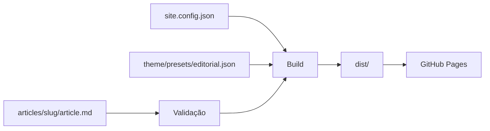

# Editorial: guia prático de tudo o que este template oferece

> Como identidade, design tokens semânticos, artigos em Markdown, busca, PWA offline, voz multilíngue e trava visual trabalham juntos sem se misturar.


Em uma pequena gráfica artesanal iluminada pela manhã, uma visitante observa sobre a bancada de carvalho uma gaveta de tipos móveis, um leque de cartelas de cor em papel texturizado e uma folha de prova recém-impressa, e pergunta ao impressor por que ele mantém o molde da página separado das amostras de tinta e do texto de cada edição; ele apoia a folha limpa ao lado das cartelas e explica que, quando a estrutura, a paleta visual e o conteúdo ocupam lugares independentes, qualquer publicação nova pode nascer ali sem reconstruir a oficina inteira. Ela acompanha o gesto e entende a economia do método: mudar o assunto ou a identidade visual exige mexer apenas na peça correspondente. O Editorial traz essa mesma separação para um blog estático, mantendo configuração, aparência, artigos, narração e verificações desacoplados em um repositório pronto para reutilização.

<div class="article-callout"><p><strong>Ideia central:</strong> o Editorial é um <span lang="en-US">template</span> de blog estático em que cada responsabilidade tem um único lugar para ser editada. Este artigo percorre esses lugares e mostra, no próprio texto, os recursos que a plataforma entrega.</p></div>

## Neste artigo

- [1. Identidade única em um arquivo de configuração](#ed-identidade)
- [2. Aparência controlada por design tokens semânticos](#ed-tokens)
- [3. Artigos em Markdown e o que o compilador entende](#ed-markdown)
- [4. O caminho do arquivo até o ar](#ed-pipeline)
- [5. Busca, favoritos e leitura offline](#ed-pwa)
- [6. Narração em português e inglês](#ed-tts)
- [7. A trava de fidelidade visual](#ed-fidelidade)
- [8. O ciclo completo, comando a comando](#ed-ciclo)
- [Resumo mental](#resumo-mental)
- [Perguntas de revisão](#perguntas-de-revisão)
- [Exercícios](#exercícios)
- [Fontes](#fontes)

<a name="ed-identidade"></a>

## 1. Identidade única em um arquivo de configuração

Tudo o que identifica o site vive em um único arquivo, `site.config.json`: nome, <span lang="en-US">slug</span>, idioma, descrição, texto de abertura da home, rodapé, tema, cor do navegador, repositório e o rótulo do áudio. O <span lang="en-US">build</span> lê esse arquivo e o injeta nas páginas, no manifesto do aplicativo e em um script que expõe `window.SiteConfig` para o restante do código.

O campo `repo` merece atenção. Vazio, ele mantém o template neutro: o botão do GitHub com contagem de estrelas fica oculto e o player não procura narrações gravadas em nenhum repositório. Preenchido com `dono/repositório`, ele acende o botão no topo e habilita a busca de MP3 nas <span lang="en-US">Releases</span> daquele repositório.

Para preencher tudo de uma vez existe um comando guiado, pensado tanto para pessoas quanto para agentes de IA, com saída em JSON e execução repetível sem efeitos colaterais:

```bash
node scripts/init-site.mjs --non-interactive --json \
  --name "Revista Clara" --subject "Economia" \
  --theme clara --tags "macro,financas" --repo "dono/revista"
```

<a name="ed-tokens"></a>

## 2. Aparência controlada por design tokens semânticos

A camada visual é um arquivo de <span lang="en-US">design tokens</span>: `theme/presets/editorial.json`. Os nomes descrevem função, nunca valor. Existe `--color-accent`, e não `--color-green`; assim, trocar a cor de destaque não deixa para trás nomes que mentem. O preset ativo, escolhido por `theme` no `site.config.json`, é compilado para `theme.css` durante o <span lang="en-US">build</span>.

Um verificador de contrato impede que a disciplina se perca: todo token definido precisa ser consumido, e as regras de componente não podem conter cores, fontes ou durações literais. Hoje são 72 tokens cobrindo cores, tipografia, espaçamento, raios, sombras, movimento e camadas de empilhamento. O diagrama do Mermaid e o registro do <span lang="en-US">service worker</span> também leem seus valores desse mesmo lugar.

| Camada | Onde editar | Comando relacionado |
| --- | --- | --- |
| Identidade | `site.config.json` | `node scripts/init-site.mjs --help` |
| Aparência | `theme/presets/editorial.json` | `node scripts/lint-tokens.mjs` |
| Conteúdo | `articles/<slug>/article.md` | `node scripts/lint-articles.mjs` |
| Receita editorial | `generation/` | `node scripts/compose-article-brief.mjs --list` |
| Voz | `tools/tts/` | `kokoro-dora article --slug <slug>` |
| Fidelidade visual | `tests/visual/` | `python scripts/snapshot-visual.py --check --build` |

<a name="ed-markdown"></a>

## 3. Artigos em Markdown e o que o compilador entende

Cada artigo é um diretório autocontido, `articles/<slug>/`, com `article.md` e a capa `cover.jpg` ao lado. O arquivo começa com metadados em YAML (categoria, datas, tempo de leitura, resumo, <span lang="en-US">tags</span> canônicas) e segue um preâmbulo fixo: um título de nível 1, uma citação que vira o subtítulo e a imagem da capa. O restante é Markdown comum com extensões.

O compilador valida o que recebe. Ele aceita tabelas, listas aninhadas, blocos de código, notas de rodapé[^1], citações e um conjunto pequeno de HTML seguro, como o destaque da ideia central acima. Em compensação, rejeita <span lang="en-US">scripts</span>, atributos de evento e links para fora do repositório que não sejam HTTPS, e falha o <span lang="en-US">build</span> se uma âncora do sumário apontar para o nada.

> Um bom formato-fonte é o que recusa o erro cedo, quando ele ainda é barato de corrigir.

Listas aninhadas também funcionam, e é com elas que a receita editorial organiza o trabalho:

- Tarefas, que dizem o tipo de artigo: `explain-concept`, `compare-approaches`, `failure-analysis` e `practical-guide`.
- Lentes, que dizem como analisar o tema:
  - `fundamentals`, para mecanismo e modelo mental;
  - `tradeoffs-and-risks`, para custos, limites e falhas;
  - `evidence-and-history`, para origem e evidências;
  - `practice-and-application`, para uso concreto.

<a name="ed-pipeline"></a>

## 4. O caminho do arquivo até o ar

Do texto à publicação, o fluxo é linear e cada etapa pode barrar a seguinte. Primeiro as fontes são compiladas e validadas; depois os tokens viram CSS; por fim o pacote vai para a pasta `dist/`, que o GitHub Pages publica.

<!-- site:mermaid {"label":"Fluxo de compilação e publicação do Editorial"} -->


<figcaption>Do texto ao ar: identidade, tema e artigos entram no <span lang="en-US">build</span>; a validação pode interromper o caminho antes da publicação.</figcaption>

<details class="mermaid-fallback">
<summary lang="pt-BR">Descrição alternativa</summary>
O arquivo de configuração e o preset de tema alimentam o build. Os artigos passam antes por uma etapa de validação e só então chegam ao build. O resultado vai para a pasta dist, publicada pelo GitHub Pages.
</details>

Os diagramas são Mermaid e precisam de legenda e de uma descrição alternativa, para que o conteúdo continue acessível mesmo que o módulo de desenho não carregue.

<a name="ed-pwa"></a>

## 5. Busca, favoritos e leitura offline

A home usa um catálogo leve, gerado no <span lang="en-US">build</span>, com os metadados e a abertura de cada artigo. É esse catálogo que alimenta a busca instantânea: ao digitar, o painel de sugestões compara título, <span lang="en-US">tags</span>, categoria e descrição, tolerando acentos, e leva direto ao artigo escolhido.

Cada cartão tem favoritos, guardados apenas no navegador de quem lê, e uma prévia rápida: passar o mouse, ou segurar o dedo no celular e arrastar até uma ação. Ao fim de cada artigo, três recomendações são escolhidas entre os outros textos.

O aplicativo também é um <span lang="en-US">PWA</span>. Um <span lang="en-US">service worker</span> guarda a casca do site e os artigos que a pessoa já visitou, de modo que eles continuam abrindo sem conexão. As atualizações chegam sem interromper quem está lendo ou ouvindo: aparece um aviso e a troca só acontece quando a pessoa pede.

<a name="ed-tts"></a>

## 6. Narração em português e inglês

Todo artigo pode ser ouvido. Sem nenhuma configuração, o botão usa a voz do próprio navegador e destaca palavras e frases enquanto fala. Com um repositório configurado, o player procura um MP3 gravado e capítulos sincronizados nas <span lang="en-US">Releases</span>, e volta à voz do navegador se não encontrar nada.

A pronúncia é controlada no próprio texto, sem alterar o que a pessoa lê na tela. Termos em inglês recebem o idioma certo, como <span lang="en-US">design tokens</span> e <span lang="en-US">service worker</span> nos parágrafos acima. Nomes técnicos ganham uma fala natural: <code lang="en-US" data-tts-say="site config jeison">site.config.json</code> é lido assim, não letra por letra. Setas com significado também: o pipeline é lido como arquivo <span data-tts-say="gera">→</span> página <span data-tts-say="gera">→</span> publicação. Siglas sem decisão editorial, como PWA, HTML e CSS, são soletradas em português.

A geração do áudio gravado usa o Kokoro com a voz `pf_dora`, localmente ou por um fluxo de trabalho do GitHub Actions disparado manualmente. Nenhuma síntese roda sozinha em <span lang="en-US">pull requests</span>.

<a name="ed-fidelidade"></a>

## 7. A trava de fidelidade visual

Separar a aparência em tokens só é seguro se existir uma prova de que nada mudou por acidente. O comparador `scripts/snapshot-visual.py` renderiza a home e um artigo em três larguras, calcula resumos dos estilos computados de elementos estáveis, confere a estrutura do DOM e compara capturas de tela pixel a pixel contra uma referência versionada em `tests/visual/baseline/`.

Funciona nos dois sentidos. Se você muda o tema de propósito, o comparador acusa exatamente quais elementos e propriedades mudaram, e você registra uma nova referência depois de revisar. Se algo muda sem querer, a verificação falha com código de saída diferente de zero e aponta o culpado.

<a name="ed-ciclo"></a>

## 8. O ciclo completo, comando a comando

Do primeiro passo ao último, o ciclo de um artigo novo cabe em poucos comandos:

```bash
node scripts/compose-article-brief.mjs --topic "Tema novo" \
  --task explain-concept --framework fundamentals
node scripts/compose-cover-brief.mjs
node scripts/validate-site.mjs
python scripts/snapshot-visual.py --check --build
node scripts/build-site.mjs
```

O primeiro gera o roteiro de escrita; a escrita em si é uma etapa humana ou de um agente de IA. O segundo monta o roteiro da capa em aquarela. Depois vêm a validação completa, a conferência visual e o pacote de produção.

## Resumo mental

O Editorial separa o blog em camadas independentes: identidade em `site.config.json`, aparência em um preset de <span lang="en-US">design tokens</span>, conteúdo em diretórios de artigo, voz em `tools/tts` e verificação em `tests/visual`. Cada camada tem um verificador que impede o vazamento para as outras, e o conjunto roda no mesmo comando de validação.

## Perguntas de revisão

Qual é a diferença de comportamento entre deixar `repo` vazio e preenchê-lo? Por que os tokens têm nomes de função em vez de nomes de cor? O que o compilador faz quando uma âncora do sumário não existe? Como o player decide entre um MP3 gravado e a voz do navegador? Em que situação o comparador visual deve falhar, e em qual deve ter a referência atualizada?

## Exercícios

1. Rode `node scripts/init-site.mjs --help`, escolha um assunto seu e inicialize o template com `--non-interactive --json`; confira no JSON quais arquivos foram gravados.
2. Altere `color.accent` no preset do tema, rode `python scripts/snapshot-visual.py --check --build` e leia o relatório de desvios; depois desfaça a mudança e confirme que a verificação volta a passar.
3. Gere o roteiro de um artigo com `node scripts/compose-article-brief.mjs --list` e, em seguida, com `--topic`, `--task` e `--framework`; compare a lista de tarefas e de lentes com as descritas na seção 3.

## Fontes

- [CommonMark: especificação do Markdown](https://commonmark.org/)
- [Mermaid: documentação de diagramas](https://mermaid.js.org/)
- [MDN: Service Worker API](https://developer.mozilla.org/en-US/docs/Web/API/Service_Worker_API)
- [MDN: Web Speech API](https://developer.mozilla.org/en-US/docs/Web/API/Web_Speech_API)
- [GitHub Docs: criando um repositório de template](https://docs.github.com/en/repositories/creating-and-managing-repositories/creating-a-template-repository)
- [Kokoro-82M no Hugging Face](https://huggingface.co/hexgrad/Kokoro-82M)

[^1]: Notas de rodapé seguem a sintaxe estendida do GitHub Flavored Markdown e são renderizadas ao fim do artigo.
