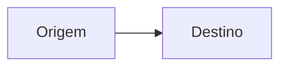

# Formato técnico dos artigos

## Fonte autocontida

Cada artigo vive em um diretório próprio: `articles/<slug>/`:

- `articles/<slug>/article.md`: fonte Markdown única do artigo (`formatVersion: 2`).
- `articles/<slug>/cover.jpg`: capa em aquarela editorial, referenciada no preâmbulo como ``.
- `articles/<slug>/figures/`: ilustrações ou anexos locais opcionais do artigo.

O slug usa letras minúsculas e hífens (`kebab-case`) e coincide exatamente com o nome da pasta em `articles/<slug>/`. Comece por [generation/templates/article.md](../generation/templates/article.md). Fontes JSON individuais não são aceitas.

No preâmbulo do Markdown, declare na sequência:

1. H1 único (`# Título`), sem marcação HTML no texto visível;
2. blockquote de uma linha com o subtítulo (`> Subtítulo curto`);
3. imagem da capa co-localizada (``);
4. primeiro parágrafo em prosa pura (diálogo-metáfora);
5. sumário `## Neste artigo` com links `#âncora` em ordem correspondente às seções.

## Renderização e segurança HTML

O compilador transforma o Markdown em slots HTML validados e aplicados no shell do artigo:

- `bodyHtml` não aceita `<script>`, `<iframe>`, `<object>`, `<embed>`, handlers inline (`on*`) nem URLs `javascript:`, `data:text/html` ou expiráveis;
- aplique marcações de pronúncia (`lang`, `data-tts-say`, `data-tts-mode`) apenas ao texto exibido, preservando `href` e `src` como URLs literais;
- não crie nem versione SVG para diagramas técnicos (SVG fica restrito ao favicon e aos ícones do shell);
- não altere o shell (`index.html`, `article.html`, `app.js`, `article.js`, `styles.css`) para acomodar um artigo específico.

## Diagramas Mermaid

Diagramas compatíveis usam cercas `mermaid` no Markdown e são renderizados pelo carregador compartilhado usando os tokens de tema lidos por `mermaid-theme.js`.

Estrutura recomendada no Markdown:

````md
<!-- site:mermaid {"label":"Descrição acessível"} -->



<figcaption>Explique o que o leitor deve observar.</figcaption>
<details class="mermaid-fallback">
<summary>Ver descrição alternativa</summary>

Descreva textualmente a relação apresentada no diagrama.
</details>
````

## Tabelas e rolagem em telas pequenas

Tabelas GFM largas são envolvidas automaticamente pelo compilador em `.article-table-scroll` (`tabindex="0"`, `role="region"`), mantendo a rolagem horizontal confinada ao componente e preservando a leitura em telas pequenas. Blocos de código e diagramas seguem o mesmo princípio: `html`, `body`, `.article-shell` e `.article-body` nunca criam scroll horizontal.

## Idioma e marcação semântica

O idioma padrão vem de `site.config.json` (no template base, `pt-BR`). Termos em outro idioma mantidos no texto são marcados com `<span lang="en-US">…</span>` no corpo ou via `speechMarkup` em `title` e `dek`, conforme [TTS.md](TTS.md).

Para códigos inline essenciais à frase e setas com significado (`→`, `←`, `↑`, `↓`), siga [AUTHORING.md](../generation/editorial/AUTHORING.md) e [TTS.md](TTS.md).

## Regra visual da capa

A capa `articles/<slug>/cover.jpg` deve ser pintura em aquarela editorial sobre papel texturizado, criada seguindo [VISUAL_STYLE.md](VISUAL_STYLE.md) e `node scripts/compose-cover-brief.mjs`. Capas SVG, 3D ou com aparência vetorial flat são rejeitadas na revisão. O build publica a capa em `assets/<slug>/cover.jpg` junto com a rota limpa `<slug>/index.html`.
